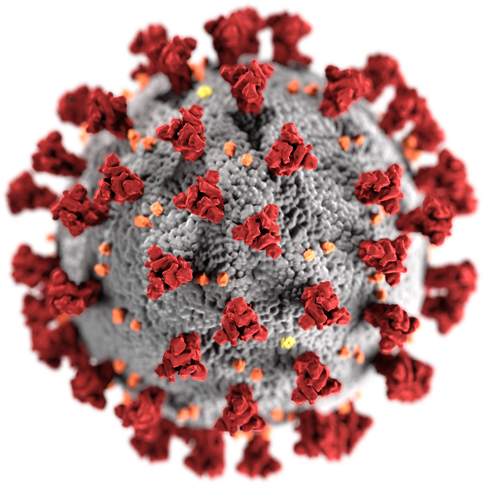
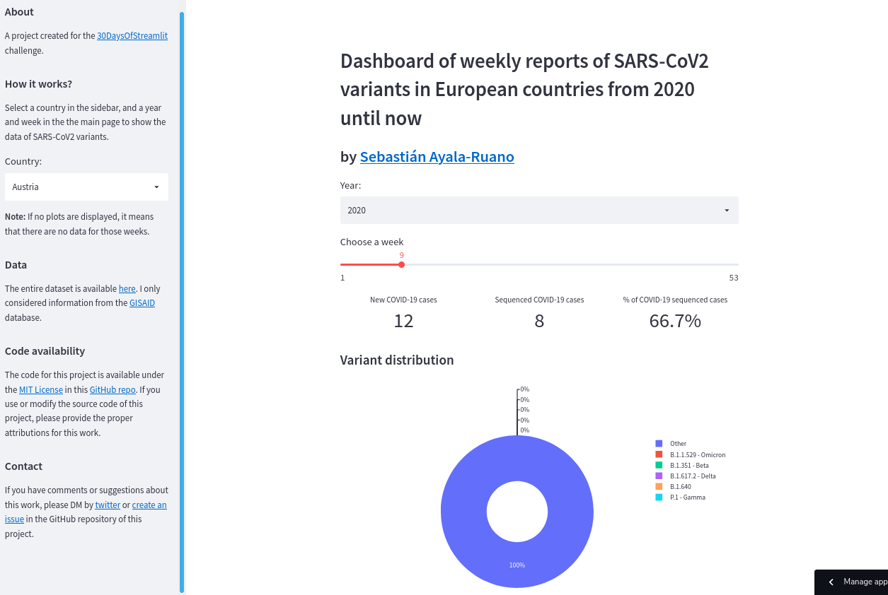

<h1 align="center">
    COVID19-EU-Dashboard
</h1>

  
   

    
    

   Dashboard of weekly reports of SARS-CoV2 variants in European countries since 2020 until April 2022

## About the project

I created this dashboard for the [30DaysOfStreamlit](https://share.streamlit.io/streamlit/30days) challenge using the [streamlit](https://streamlit.io/) Python package.

The screenshot below shows how this dashboard looks like: 

 

 

You can access the web application of this dashboard with this [link](https://sars-cov2-eu-countries-report.streamlit.app/).

## Dataset 

The entire dataset is available [here](https://www.ecdc.europa.eu/en/publications-data/data-virus-variants-covid-19-eueea). I only considered information from the [GISAID](https://www.gisaid.org/) database.

## Contact 

If you have any comments or suggestions about this work, [open an issue](https://github.com/sayalaruano/Dashboard_SARS-CoV2_variants_Europe/issues/new) in this GitHub repository.

## Acknowledgments

Special thanks to [Data Professor](https://github.com/dataprofessor) and [Ken Jee](https://github.com/PlayingNumbers) for creating tutorials to build a dashboard with streamlit: https://www.youtube.com/watch?v=fThcHGiTOeQ&list=PLtqF5YXg7GLmCvTswG32NqQypOuYkPRUE&index=45 and https://www.youtube.com/watch?v=Yk-unX4KnV4. I took their code as the baseline to create this project.
